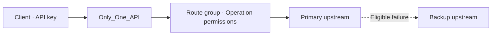

<div align="center">
  <h1>Only_One_API</h1>
  <p><a href="README.md">简体中文</a> · <strong>English</strong></p>
  <p><strong>One endpoint for multiple APIs, with scoped keys and ordered upstream failover.</strong></p>
  <p>
    
    
    
  </p>
</div>

[Quick start](#quick-start) · [AI providers](#connect-ai-providers) · [HTTP proxy](#proxy-http-services) · [Client examples](#client-examples) · [Failover](#failover) · [Deployment](#deployment-and-maintenance) · [Troubleshooting](#troubleshooting)

Only_One_API is a self-hosted API gateway for OpenAI-compatible providers and general HTTP services. Use its bilingual admin console to configure upstreams, rank primary and backup services, and issue a separate API key for each application. The server uses Node.js with built-in SQLite and has zero npm dependencies.



## Quick start

Download or clone the repository and open a terminal in the project root. Install **Node.js 24 or later** and confirm the version with `node --version`. [Download Node.js](https://nodejs.org/en/download)

| Platform | Terminal | Start command |
| --- | --- | --- |
| Windows | PowerShell or Windows Terminal | `node --env-file-if-exists=.env src/server.js` |
| macOS | Terminal with zsh or bash | `node --env-file-if-exists=.env src/server.js` |
| Linux | bash or a compatible shell | `node --env-file-if-exists=.env src/server.js` |

1. Keep the server running. On first launch, save the password printed after `Admin password (shown once)`.
2. Open `http://127.0.0.1:8787` in your browser and sign in with the admin password. The language menu on the sign-in page and in the console switches between Simplified Chinese and English. Your browser remembers the selection.
3. Configure **上游服务** (Upstreams), then **路由组** (Route groups), then **API Key**. Use the admin password for the console and an issued key for API calls.

`npm start` runs the same server. If npm cannot locate `node` on Windows, use the direct command above. Press `Ctrl+C` to stop the server. Settings persist under `data/` and are loaded on subsequent starts.

## Connect AI providers

This example exposes two Chat Completions providers through the `chat-main` route alias. Replace the example URLs and model IDs with the values for your providers.

### 1. Add upstreams

Open **上游服务 → 新建上游** (Upstreams → New upstream) and select **OpenAI 兼容** (OpenAI-compatible). Add the primary and backup upstreams separately.

| Field | Primary example | Backup example |
| --- | --- | --- |
| Upstream name | `Primary` | `Backup` |
| Provider | `Provider A` | `Provider B` |
| Base URL | `https://primary.example/v1` | `https://backup.example/api/v1` |
| Default model | `provider-a-model` | `provider-b-model` |
| Auth header / prefix | `Authorization` / `Bearer ` | As required by the backup provider |
| Upstream credential | Primary provider's key | Backup provider's key |
| Operation | Chat, `POST /chat/completions` | Chat, `POST /chat/completions` |
| Probe method and path | `GET /models` if supported | A supported health endpoint |

The gateway appends the operation path to the upstream Base URL. For example, `https://primary.example/v1` and `/chat/completions` produce `https://primary.example/v1/chat/completions`. Keep the trailing space in `Bearer ` because the gateway concatenates the prefix and credential. For an upstream that uses `X-API-Key`, the prefix is usually empty. After saving, click **探测** (Probe) in the upstream list to test the configured endpoint.

### 2. Create a route group

Open **路由组 → 新建路由组** (Route groups → New route group). Select **OpenAI 兼容**, enter `chat-main` as the public alias, and choose **对话** (Chat). Add both members and move the primary to the top. Set a member's model override if this route needs a different model from the upstream default.

Every member must support the same operations and HTTP methods declared by the group. If chat and embeddings use different models, create separate groups such as `chat-main` and `embed-main` and grant access independently.

### 3. Issue a key and configure the client

Open **API Key → 签发 Key** (Issue key). Name the key for your application and select the chat operation for `chat-main`. Set an expiration time and a per-minute request limit as needed. The complete key appears once when you issue it.

Use the following settings in any client that accepts a custom OpenAI-compatible endpoint. For a remote deployment, substitute your HTTPS origin.

| Client setting | Value |
| --- | --- |
| Base URL | `http://127.0.0.1:8787/v1` |
| API key | The `ooa_…` key issued by the console |
| Model ID | `chat-main` |

## Proxy HTTP services

Suppose an existing inventory service exposes `GET https://inventory.example/v2/items?sku=A001`. You can issue a key scoped to that lookup.

1. Create an **HTTP 反代** (HTTP proxy) upstream. Set the Base URL to `https://inventory.example/v2` and add a `lookup` operation with method `GET` and path `/items`. Add credentials and a health probe as needed.
2. Create an **HTTP 反代** route group with alias `inventory` and expose the `lookup` operation as `GET`. A backup can use a different upstream path as long as it defines the same operation name and method.
3. Issue a key with permission for `inventory` → `lookup`. Call `GET /api/inventory/lookup?sku=A001`. The gateway forwards the query string.

```bash
curl -fsS 'http://127.0.0.1:8787/api/inventory/lookup?sku=A001' \
  -H "X-API-Key: $OOA_API_KEY"
```

Supported methods are `GET`, `HEAD`, `POST`, `PUT`, `PATCH`, and `DELETE`. Each operation maps to a configured method and fixed upstream path. Methods that accept a body can forward it. The gateway consumes client API keys and cookies locally. Browser sessions, WebSockets, and third-party sign-in are handled by their respective services.

## Client examples

The examples use the `chat-main` route alias. Replace the placeholder with an issued key. `OOA_BASE_URL` is the gateway origin. SDKs that accept an OpenAI-compatible Base URL need the `/v1` suffix.

<details open>
<summary><strong>macOS / Linux · curl</strong></summary>

```bash
export OOA_BASE_URL='http://127.0.0.1:8787'
export OOA_API_KEY='REPLACE_WITH_YOUR_GATEWAY_KEY'

curl -fsS "$OOA_BASE_URL/v1/models" \
  -H "Authorization: Bearer $OOA_API_KEY"

curl -fsS -N "$OOA_BASE_URL/v1/chat/completions" \
  -H "Authorization: Bearer $OOA_API_KEY" \
  -H 'Content-Type: application/json' \
  --data '{"model":"chat-main","messages":[{"role":"user","content":"Hello"}],"stream":true}'
```

`-N` disables curl's output buffering. Omit `stream` or set it to `false` for a regular JSON response.

</details>

<details open>
<summary><strong>Windows · PowerShell</strong></summary>

```powershell
$env:OOA_BASE_URL = 'http://127.0.0.1:8787'
$env:OOA_API_KEY = 'REPLACE_WITH_YOUR_GATEWAY_KEY'
$headers = @{ Authorization = "Bearer $env:OOA_API_KEY" }

Invoke-RestMethod -Uri "$env:OOA_BASE_URL/v1/models" -Headers $headers

$body = @{
  model = 'chat-main'
  messages = @(@{ role = 'user'; content = 'Hello' })
} | ConvertTo-Json -Depth 5

$result = Invoke-RestMethod -Uri "$env:OOA_BASE_URL/v1/chat/completions" `
  -Method Post -Headers $headers -ContentType 'application/json; charset=utf-8' `
  -Body ([System.Text.Encoding]::UTF8.GetBytes($body))
$result.choices[0].message.content
```

</details>

<details>
<summary><strong>Python · OpenAI SDK</strong></summary>

Install the SDK with `python3 -m pip install openai`, or use `py -m pip install openai` with the Windows Python Launcher. [Python SDK](https://github.com/openai/openai-python)

```python
import os
from openai import OpenAI

origin = os.getenv("OOA_BASE_URL", "http://127.0.0.1:8787").rstrip("/")
client = OpenAI(base_url=f"{origin}/v1", api_key=os.environ["OOA_API_KEY"], max_retries=0)

stream = client.chat.completions.create(
    model="chat-main",
    messages=[{"role": "user", "content": "Hello"}],
    stream=True,
)
for chunk in stream:
    if chunk.choices and chunk.choices[0].delta.content:
        print(chunk.choices[0].delta.content, end="", flush=True)
print()
```

</details>

<details>
<summary><strong>JavaScript · Node.js fetch</strong></summary>

Save as `chat.mjs` and run `node chat.mjs`.

```js
const origin = process.env.OOA_BASE_URL ?? 'http://127.0.0.1:8787';
const response = await fetch(new URL('/v1/chat/completions', origin), {
  method: 'POST',
  headers: {
    Authorization: `Bearer ${process.env.OOA_API_KEY}`,
    'Content-Type': 'application/json'
  },
  body: JSON.stringify({
    model: 'chat-main',
    messages: [{ role: 'user', content: 'Hello' }]
  })
});

const data = await response.json();
if (!response.ok) throw new Error(`HTTP ${response.status} · ${JSON.stringify(data)}`);
console.log(data.choices[0].message.content);
```

</details>

<details>
<summary><strong>Go · net/http</strong></summary>

Save as `chat.go` and run `go run chat.go`. This example prints the complete JSON response.

```go
package main

import (
    "fmt"
    "io"
    "log"
    "net/http"
    "os"
    "strings"
    "time"
)

func main() {
    origin := os.Getenv("OOA_BASE_URL")
    if origin == "" {
        origin = "http://127.0.0.1:8787"
    }
    payload := `{"model":"chat-main","messages":[{"role":"user","content":"Hello"}]}`
    req, err := http.NewRequest("POST", strings.TrimRight(origin, "/")+"/v1/chat/completions", strings.NewReader(payload))
    if err != nil {
        log.Fatal(err)
    }
    req.Header.Set("Authorization", "Bearer "+os.Getenv("OOA_API_KEY"))
    req.Header.Set("Content-Type", "application/json")

    client := &http.Client{Timeout: 130 * time.Second}
    res, err := client.Do(req)
    if err != nil {
        log.Fatal(err)
    }
    defer res.Body.Close()
    body, err := io.ReadAll(res.Body)
    if err != nil {
        log.Fatal(err)
    }
    if res.StatusCode >= 400 {
        log.Fatalf("%s %s", res.Status, body)
    }
    fmt.Println(string(body))
}
```

</details>

### API reference

| Method and path | Purpose | Main inputs |
| --- | --- | --- |
| `GET /healthz` | Check that the gateway is running | No key required |
| `GET /v1/models` | List enabled AI route aliases accessible to the key | API key |
| `POST /v1/chat/completions` | Chat Completions with optional streaming | `model`, `messages`, optional `stream` |
| `POST /v1/responses` | Responses with optional streaming | `model`, `input`, optional `stream` |
| `POST /v1/embeddings` | Generate embeddings | `model`, `input` |
| `/api/<route-alias>/<operation>` | Call a fixed HTTP operation | Configured method, query parameters, and body |

Except for the health check, these endpoints accept `Authorization: Bearer <gateway-key>` or `X-API-Key: <gateway-key>`. For AI requests, `model` is the route alias. The upstream protocol defines the remaining fields and successful response. Access is granted per operation. The request body limit is 8 MiB.

## Failover

Each request starts with the highest-priority member. The gateway skips disabled members and probes eligible candidates when probing is enabled for the group. A GET or HEAD probe passes on `2xx`. If its path is empty, the business request itself determines availability. AI upstreams with a chat operation can also use a minimal POST chat probe, which may consume provider quota.

| Situation | Behavior |
| --- | --- |
| A candidate fails its probe | Skip it and try the next member |
| Connection failure, timeout, `408`, `429`, or `5xx` | Try the next member if retries are allowed and output has yet to begin |
| AI upstream returns `401`, `402`, `403`, or `404` | Treat the current member as unavailable and fall back if retries are allowed |
| General HTTP `GET` or `HEAD` | Automatic failover is allowed |
| General HTTP write request | By default, failover occurs only before forwarding. Enable replay explicitly to retry after forwarding |
| AI request | Retries before output are enabled by default and configurable per group |
| The gateway has started streaming to the client | A later interruption ends the stream and is logged as a failure |

Replaying a request may repeat an operation or incur a second charge. You can configure the group deadline, probe timeout, and per-upstream timeout separately. Give the group enough time for probes and backups after the primary times out.

## Deployment and maintenance

### Environment variables

Create `.env` from [`.env.example`](.env.example). Run `Copy-Item .env.example .env` in PowerShell or `cp .env.example .env` on macOS or Linux.

| Variable | Default | Purpose |
| --- | --- | --- |
| `OOA_HOST` | `127.0.0.1` | Listen address |
| `OOA_PORT` | `8787` | Listen port |
| `OOA_DATA_DIR` | `./data` | SQLite and encryption key directory, relative to the working directory |
| `OOA_ADMIN_PASSWORD` | Randomly generated | Password used during initial setup or reset, 16–256 characters |
| `OOA_SECURE_COOKIE` | `0` | Set to `1` when the admin console is served over HTTPS |

### HTTPS and persistence

For remote access, keep the gateway bound to `127.0.0.1`, use an HTTPS reverse proxy on the same host, and set `OOA_SECURE_COOKIE=1`. The example belongs inside an existing Nginx HTTPS `server` block. [Nginx proxy module](https://nginx.org/en/docs/http/ngx_http_proxy_module.html)

```nginx
location / {
    proxy_pass http://127.0.0.1:8787;
    proxy_http_version 1.1;
    proxy_buffering off;
    proxy_read_timeout 610s;
    client_max_body_size 8m;
}
```

The gateway is designed for a single instance and one administrator. It encrypts upstream credentials using AES-256-GCM and stores gateway keys as digests. To back up the instance, stop the server and copy the entire data directory, including `gateway.sqlite` and `vault.key`. Restrict access to the backup and restore both files to the same data directory.

Run the following from the project root to reset the administrator password. Existing sessions expire immediately. If `OOA_ADMIN_PASSWORD` is set, the reset uses that value.

```sh
node --env-file-if-exists=.env src/server.js --reset-admin
```

## Troubleshooting

| Symptom | What to check |
| --- | --- |
| Admin console is unreachable | Confirm the address and port in the terminal, then try `/healthz` |
| `401` | Check that the gateway key is enabled and has yet to expire |
| `403` | Check that the key grants access to this operation in this group |
| `404` or `405` | Verify the alias, operation, and method, and confirm that the route is enabled |
| `429` | Check `Retry-After` and the logs to distinguish a gateway key limit from an upstream limit |
| `502` or `504` | Filter **调用日志** (Request logs) by route, expand the attempts, and match `X-Request-ID` from the response |
| Probe fails but the model works | Verify that the method and path are supported, or clear the GET / HEAD probe path to use the actual request |
| Streaming output arrives all at once | Enable `stream`, disable proxy response buffering, and use `-N` with curl |

The dashboard shows request volume, success rate, and failovers over the past 24 hours. Logs cover up to seven days and are periodically trimmed to 20,000 entries. They record routes, request IDs, statuses, and upstream attempts. Request bodies, query strings, and credential fields are excluded from call logs.

## Development and tests

```text
public/          Bilingual admin console
src/server.js    HTTP server, admin API, and public routes
src/config.js    Upstream, route group, and API key validation
src/gateway.js   Probing, forwarding, and failover
src/store.js     SQLite persistence and credential storage
test/            Integration tests with local mock upstreams
```

```sh
node --test
```

The integration tests use temporary SQLite storage and local mock services to cover ordered failover, model rewriting, SSE, HTTP proxying, and key permissions. The test environment needs loopback networking.
